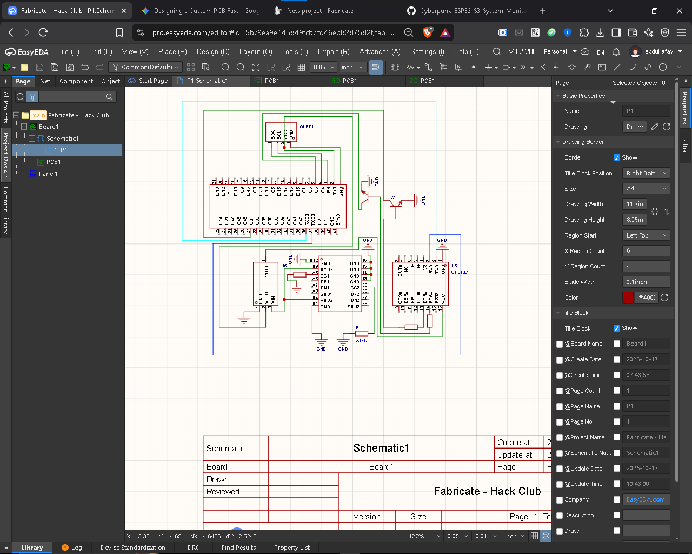
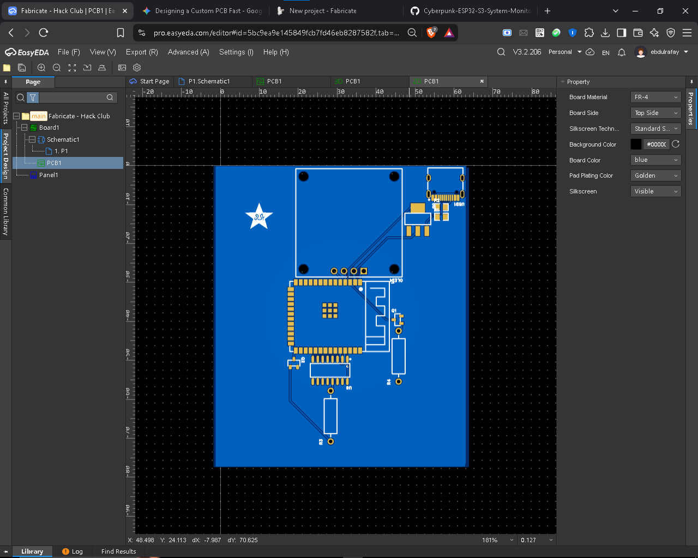
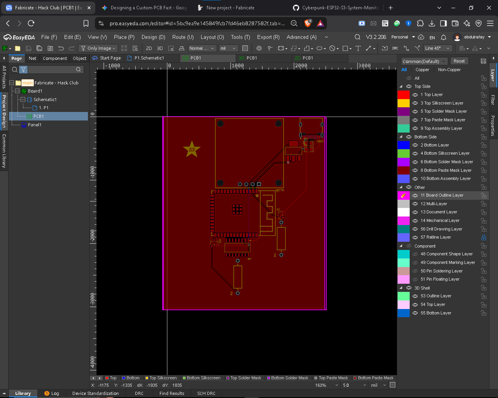
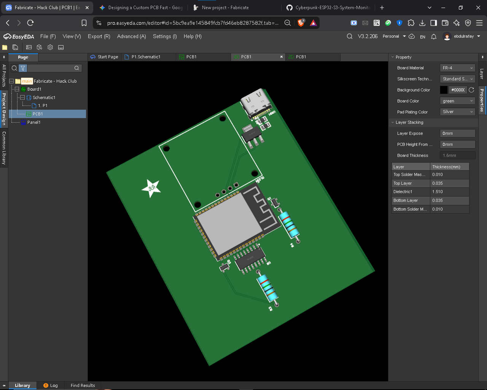

# 🚀 Cyberpunk ESP32-S3 System Monitor - Engineering Journal

Welcome to the development log for the **Cyberpunk ESP32-S3 System Monitor PCB**. This journal documents the design, routing, aesthetic customization, and fabrication readiness of the custom hardware board.

---

## 📅 Entry 1: Schematic Design
- **Date:** October 17, 2026
- **Status:** Completed

### Highlights:
- Designed the core schematic integrating the **ESP32-S3 microcontroller module**, USB-C power/data input, LDO voltage regulator, OLED display header, and support passive components.

### Schematic Preview:

---

## 📅 Entry 2: PCB Layout & Routing
- **Date:** October 17, 2026
- **Status:** Completed

### Highlights:
- Performed trace routing for power, ground, and high-speed data lines.
- Resolved trace crossover issues and cleared all Design Rule Check (DRC) errors (`0 Errors`).

### 2D Layout View:

---

## 📅 Entry 3: Ground Copper Pour & Branding
- **Date:** October 17, 2026
- **Status:** Completed

### Highlights:
- Applied a **Solid Ground Copper Pour (`GND`)** on the top layer to provide noise immunity and signal integrity.
- Imported custom **ROEX Branding Logo** onto the `Top Silkscreen Layer` for a cyberpunk aesthetic.

### PCB Layout (Copper Pour & Silkscreen):

---

## 📅 Entry 4: 3D Visualization & Final Gerber Verification
- **Date:** October 17, 2026
- **Status:** Ready for Fabrication

### Highlights:
- Inspected the final board in EasyEDA's 3D Viewer to verify component clearances and connector orientations.
- Generated final **Gerber files** for manufacturing.

### Main 3D Board Render:

---

## 🛠 Tech Stack & Tools
- **EDA Tool:** EasyEDA
- **MCU:** ESP32-S3
- **Power:** USB-C 5V to 3.3V LDO
- **Branding:** Custom Silkscreen Art
- **Fabrication Platform:** Hack Club Fabricate / JLCPCB
